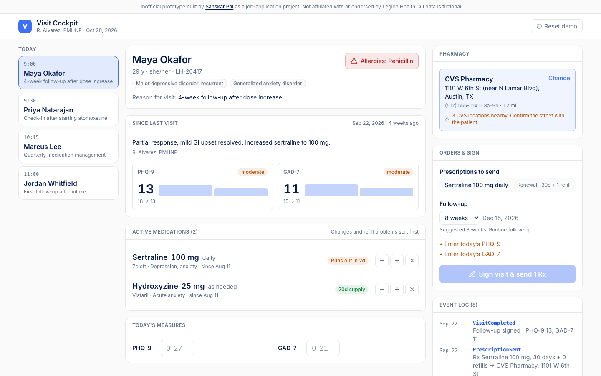

# Visit Cockpit

The screen a psychiatric nurse practitioner works from during a live visit: what changed since last time, which meds need attention, and an unambiguous pharmacy, all readable in a few seconds. An unofficial prototype for Legion Health, built by Sanskar Pal while applying for the Product Engineer, Care Loop role.

**Live demo:** _coming soon_ · **Stack:** React 19, TypeScript, Tailwind v4, Vitest



## Why

Legion's [Care Loop posting](https://jobs.ashbyhq.com/legionhealth/ffdd2b52-eb21-489e-b124-3c0804231424) names the gaps blocking a full clinic day on the platform: prior-visit context at a glance, medication lists a clinician can scan in seconds, and unambiguous pharmacy selection. It also says the clinical record is event-sourced (orders, tasks, receipts). This prototype tackles those three screens on top of a small event-sourced record.

## What it does

- **Since last visit**: last visit summary, PHQ-9 and GAD-7 trends (today's score added live), and a warning for any med stopped since the last visit, so nobody restarts it by accident.
- **Scannable medication list**: dose in large type; anything new, re-dosed, lapsed or running out sorts to the top with a badge ("↑ from 100 mg", "Runs out in 2d").
- **Unambiguous pharmacy picker**: when three CVS stores are nearby, each option leads with the detail that tells them apart (street, or cross street when two share a street) and the selection warns you to confirm.
- **Orders that follow from the visit**: changing a dose queues a prescription at the new strength; a med about to run out queues a renewal; the follow-up interval is suggested from rules that explain themselves.
- **Event log**: every action is an event. Changes stay as drafts until you sign; signing appends drafts, prescriptions, the follow-up and the visit record in one commit. Undo removes the last draft.

Try it: on Maya Okafor, press **+** on sertraline, enter a PHQ-9 and GAD-7, then sign.

## How it works

The chart is never stored. It's a projection: `project(patientId, events)` folds the event list in time order ([src/lib/projection.ts](src/lib/projection.ts)). Replaying the same events always gives the same chart, which is why the log can be the source of truth.

- [src/lib/types.ts](src/lib/types.ts): the `ClinicalEvent` union (`MedStarted`, `DoseChanged`, `MedStopped`, `PharmacySelected`, `PrescriptionSent`, `FollowUpScheduled`, `VisitCompleted`) and the projected `Chart`.
- [src/lib/visit.ts](src/lib/visit.ts): commands turn intent into events and validate it ("already at its highest listed dose"). `signVisit` checks the blockers, then emits the prescriptions, follow-up and visit record.
- [src/lib/meds.ts](src/lib/meds.ts): change detection against the dose in effect at the last visit, refill math (days supply × (1 + refills)), and the scan order.
- [src/lib/pharmacy.ts](src/lib/pharmacy.ts): lookalike detection and the distinguishing label.
- [src/state/cockpit.ts](src/state/cockpit.ts): a reducer holding the signed log plus per-patient drafts.

22 unit tests cover the projection, change detection, refill math, commands, signing and pharmacy disambiguation (`npm test`).

## Tradeoffs and what I'd do next

- Fictional patients and a toy formulary. Dose steps are illustrative, not dosing guidance.
- State lives in memory; a real version persists events to Postgres with an append-only table, and the projection becomes a cached read model.
- No auth, no audit identity beyond a provider name, no e-prescribing integration.
- Next: drug–drug interaction and allergy checks as blockers at sign time, a keyboard-only flow for a clinician mid-conversation, and an agent that drafts the visit note from the event diff for the provider to approve.

## Run locally

```bash
npm install
npm run dev
npm test
```

---

Not affiliated with or endorsed by Legion Health. All data is fictional. Not medical software.
